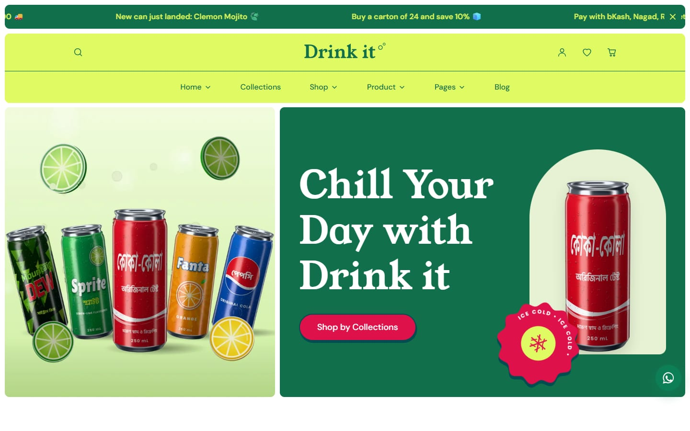
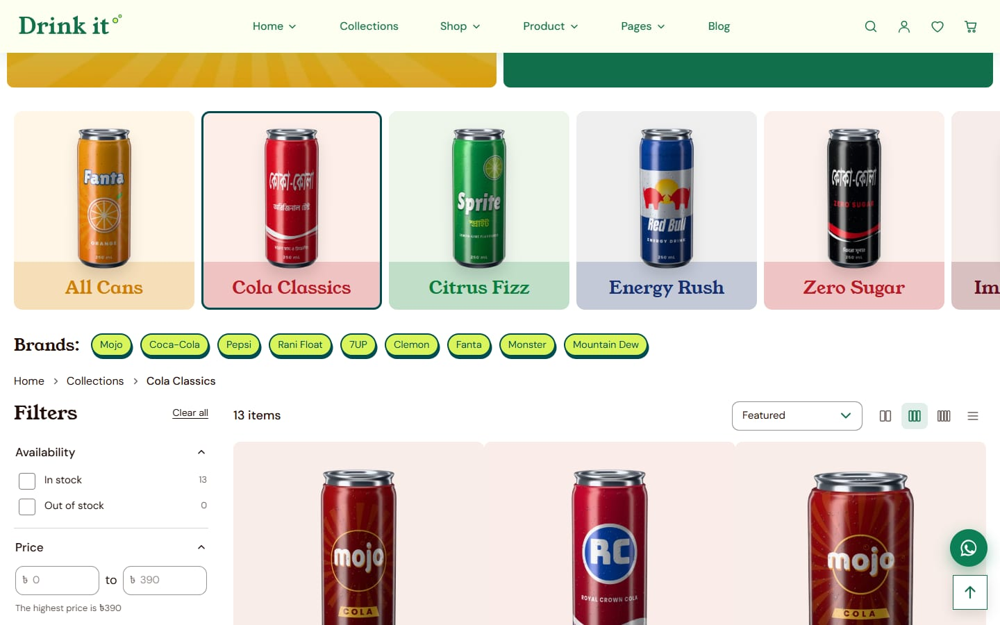
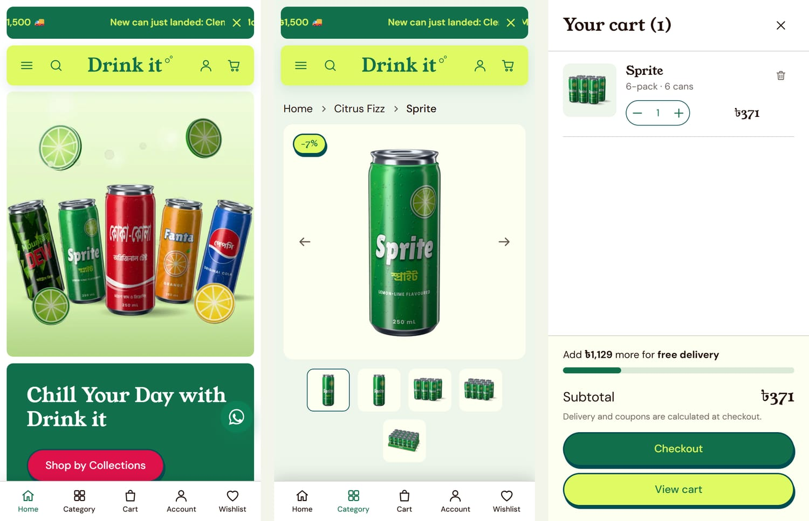
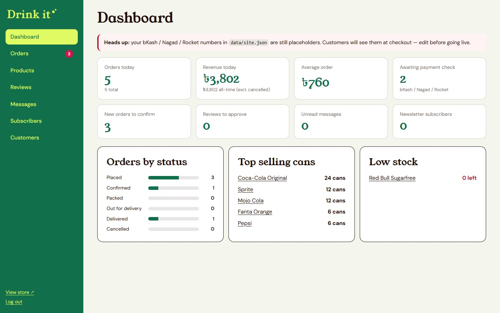

# Drink it

[](https://github.com/mahmudultopu/drink-it/actions/workflows/ci.yml)
[](LICENSE)
[](https://nodejs.org)

An online shop for canned cold drinks in Bangladesh: Coca-Cola, Pepsi, Sprite, 7UP, Fanta, Mojo, Clemon, Speed, Red Bull,
imported cans and more, sold as singles, 6-packs, 12-packs and cartons of 24. Customers order from the Drink it site
itself and pay by cash on delivery, bKash, Nagad or Rocket; orders land in an admin dashboard.

**Live preview:** <https://drink-it-drab.vercel.app> — a demo deployment. You can browse, fill a cart and check out, but
orders there are not saved (see [Deployment](#deployment)).



## Highlights

- **No runtime dependencies.** The server is plain Node.js (`node:http`) and the front end is vanilla ES modules; the
  only `devDependencies` are for linting, bundling and generating images. `npm audit` for production dependencies is
  empty by construction.
- **Fast on a phone.** Pages ship their banner, title and main photo in the first HTML, assets are bundled, fingerprinted
  and cached for a year, and images are sent at the size they are shown. On a throttled phone the product page paints its
  main photo in 1.5 s instead of 5.2 s and the collection page no longer shifts at all
  ([measurements](docs/performance.md)).
- **Secure by default.** Prices and stock are decided on the server, passwords use scrypt, sessions are signed
  `HttpOnly` cookies, cross-site requests are refused, and a strict Content-Security-Policy forbids inline scripts
  ([details](SECURITY.md)).
- **Tested.** More than 200 tests run on Node's built-in runner, including real-browser checks of every page, layout
  stability and the purchase flow - against both the readable sources and the production build.



## Features

**Storefront** — two home layouts; collections with filters (brand, flavour, sugar, origin, size, price) and sorting
whose state lives in the URL; product pages with a gallery, pack picker, delivery estimate and reviews; cart drawer and
page; checkout with Bangladeshi divisions and districts; order confirmation and tracking by order number and phone;
accounts with saved addresses; wishlist, compare and search; blog, FAQ, delivery areas, policies and contact form. It is
responsive down to small phones, with a tab bar on mobile.

**Admin** (`/admin`) — dashboard, orders with a status flow, payment verification, CSV export and print slip, price and
stock editing, review moderation, contact messages, subscribers and customers.





## Getting started

You need [Node.js](https://nodejs.org) 20.19 or newer.

```bash
git clone https://github.com/mahmudultopu/drink-it.git
cd drink-it
npm ci          # development tools only
npm start       # http://localhost:3000
```

The first start prints a generated admin password once; sign in at <http://localhost:3000/admin>.
`node server.js --reset-admin` issues a new one. On Windows, `start.bat` does the same and opens the browser.

For the production build (bundled, minified, fingerprinted assets) run `npm run build` before `npm start`; the server
picks it up automatically.

### Scripts

| Command                                | What it does                                                                  |
| -------------------------------------- | ----------------------------------------------------------------------------- |
| `npm start`                            | Run the shop                                                                  |
| `npm run build`                        | Bundle, minify and fingerprint the front end into `public/assets/dist`        |
| `npm test`                             | Unit, end-to-end and browser tests                                            |
| `npm run check`                        | Lint, formatting check and tests (what CI runs)                               |
| `npm run lint` / `format`              | ESLint / Prettier                                                             |
| `npm run measure`                      | Page-load measurements under throttling ([how](docs/performance.md))          |
| `npm run screenshots`                  | Regenerate the images in `docs/screenshots`                                   |
| `npm run render`                       | Render the can images with three.js (needs Chrome; see below)                 |
| `npm run build:catalog`                | Regenerate `data/*.json` from `scripts/catalog.mjs` (resets stock and prices) |
| `npm run build:images` / `build:fonts` | Responsive image sizes / self-hosted fonts                                    |

## Configuration

Settings are environment variables; the defaults suit local development.

| Variable                 | Purpose                                                                          |
| ------------------------ | -------------------------------------------------------------------------------- |
| `PORT`, `HOST`           | Where to listen (`3000` on `127.0.0.1`; use `HOST=0.0.0.0` to test from a phone) |
| `DRINKIT_DATA_DIR`       | Folder for the JSON data files (default `./data`)                                |
| `DRINKIT_ADMIN_PASSWORD` | Admin password; if unset a random one is generated and printed on first start    |
| `DRINKIT_SECRET`         | Cookie-signing key, 32+ characters; if unset one is generated into `data/`       |
| `DRINKIT_SECURE_COOKIES` | Set to `1` behind HTTPS: secure cookies, HSTS, `upgrade-insecure-requests`       |
| `DRINKIT_TRUST_PROXY`    | Number of reverse proxies in front (so rate limits see the visitor's address)    |
| `DRINKIT_PUBLIC_URL`     | Canonical origin for `sitemap.xml`, `robots.txt` and canonical links             |

### Before going live

Edit `data/site.json` (it is picked up without a restart): contact details, delivery fees and the free-delivery
threshold, the bKash, Nagad and Rocket **merchant numbers (currently `01XXX-XXXXXX` placeholders; the dashboard warns
until they are replaced)**, announcement messages and social links. Coupons are in `data/coupons.json`. Prices in
`data/products.json` are indicative; edit them in the dashboard or in `scripts/catalog.mjs`. The sample reviews and
home-page testimonials are placeholders too.

## How it works

```text
server.js, server/   Node HTTP server: pages, JSON API, authentication, JSON-file storage
views/, partials/    HTML templates (rendered with titles, meta tags and the banner already filled in)
public/assets/       Browser code (ES modules), stylesheets, fonts and images
data/                Catalogue and configuration as JSON; orders and accounts are written here too
scripts/             Asset build, catalogue generator, can renderer and other tooling
test/                Unit, end-to-end and browser tests
docs/                Architecture and performance notes
```

[docs/architecture.md](docs/architecture.md) follows a request from the browser through the server and explains the
storage, pricing, authentication, asset pipeline and deployment choices.

### Product images

The can photographs are rendered, not photographed: `scripts/render` draws aluminium cans with printed labels in
three.js inside headless Chrome (`npm run render`, about five minutes on a laptop GPU). They approximate the real packs.
A real photo dropped into `scripts/render/inbox/<product-handle>.jpg` takes precedence: the next render cuts it out and
rebuilds every pack image from it ([instructions](scripts/render/inbox/README.md)). Use photos you have the right to use,
for example ones supplied by a brand or distributor.

## Deployment

**A server with a persistent disk** (a VPS, or a container with a volume): `npm ci && npm run build && npm start` behind
an HTTPS reverse proxy, with `DRINKIT_SECURE_COOKIES=1`, `DRINKIT_TRUST_PROXY=1`, `DRINKIT_PUBLIC_URL` and a long
`DRINKIT_ADMIN_PASSWORD`. Orders, accounts and reviews are stored in `data/`; back that folder up. This is the setup for
a shop that takes real orders.

**Vercel (preview only).** [`vercel.json`](vercel.json) runs the build, serves `public/` from the CDN and sends every
other request to the serverless function in `api/index.js`. A function has no persistent disk, so orders, accounts and
reviews live in `/tmp` and disappear on a cold start; every page says so. Set `DRINKIT_ADMIN_PASSWORD` and
`DRINKIT_SECRET` in the project settings to enable the dashboard and keep sessions valid across instances. For real
orders use a host with a disk or replace `server/db.js` with a database
([scaling up](docs/architecture.md#scaling-up)).

## Notes

- **Payments.** Cash on delivery works as is. bKash, Nagad and Rocket use the usual "send money, then quote the
  transaction ID" flow: the customer pays your number, enters the transaction ID, and an administrator marks the payment
  as paid after checking it. Card payments are shown as unavailable; a gateway would plug in at `server/routes.js`.
- **Notifications.** The shop sends no email or SMS. New orders appear in the dashboard, with a badge for the ones waiting.
- **Brands.** Brand names and pack designs appear only to identify the products for sale; the images are in-house
  renders, not official packshots. This project is not affiliated with any of the brands.

## Contributing

Issues and pull requests are welcome; see [CONTRIBUTING.md](CONTRIBUTING.md). Please report security problems privately,
as described in [SECURITY.md](SECURITY.md).

## Credits and licence

Released under the [MIT licence](LICENSE).

The visual design is inspired by the _Feezee_ food-and-beverage theme; all code and artwork in this repository are original.
Self-hosted fonts: Young Serif and DM Sans, plus small Noto Bengali subsets for the ৳ sign (all SIL Open Font License,
from Google Fonts). Fonts used on the can labels, also under the OFL, live in `scripts/fonts`: Poppins, Anton, Lilita One,
Righteous, Pacifico, Lobster, Russo One, Bungee, Bebas Neue, Oswald, Fredoka, Young Serif, Galada, Hind Siliguri, Atma,
Baloo Da 2 and Tiro Bangla. Rendering uses [three.js](https://threejs.org) (MIT).
