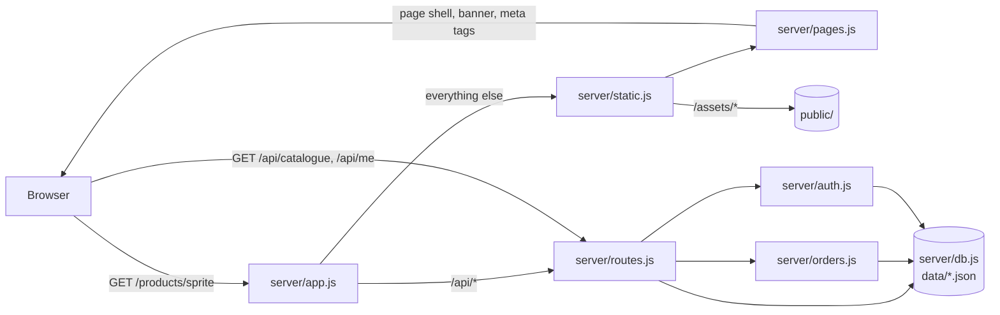

# Architecture

Drink it is an online shop for canned cold drinks. It is deliberately small: a Node.js server with no runtime
dependencies, HTML templates, and a browser front end written as plain ES modules. This document explains how the
pieces fit together and why they are built the way they are.

## Goals

- **Easy to run and read.** `npm start` is all it takes; there is no framework to learn and no database to install.
- **Safe by default.** Prices and stock are decided on the server, input is validated, and responses carry strict
  security headers (see [SECURITY.md](../SECURITY.md)).
- **Fast on a phone.** Pages are small shells, the front end is split per page, assets are fingerprinted and cached
  for a year, and images are sent at the size they are displayed.
- **Honest about its limits.** Storage is a JSON file per collection, which suits one server process and a modest
  catalogue. [Scaling up](#scaling-up) explains what to replace first.

## Request flow

1. **The page.** The server answers every storefront URL with an HTML shell (`views/*.html` plus the shared
   `partials/`). It renders everything that is known up front: the title, description and social-card tags, and the
   banner with its heading and intro text. A view describes itself in a header comment
   (`<!--page {"title": "About Us", "text": "..."} -->`); for products, collections, articles and policies the real
   data replaces it. Link previews and search engines therefore see real content, and the first screen does not wait
   for any script.
2. **The data.** While the browser parses that shell, two requests that the page head announced with `rel=preload`
   are already under way: `/api/catalogue` (the same for everybody, so it is cached and compressed once and shared)
   and `/api/me` (the signed-in customer, never cached).
3. **The page script.** `assets/js/app.js` waits for both, builds the client-side `Store`, starts the shared
   header, cart drawer and search, and then loads the module for the current page (`pages/home.js`,
   `pages/product.js`, ...). That module renders into the containers the shell provides.
4. **Actions.** Adding to the cart only touches `localStorage`. Checkout, accounts, reviews and the admin dashboard
   call the JSON API.

## Server modules

| Module              | Responsibility                                                                                               |
| ------------------- | ------------------------------------------------------------------------------------------------------------ |
| `server.js`         | Process entry: configuration checks, first-run admin password, timeouts, graceful shutdown                   |
| `server/app.js`     | Request listener shared with the Vercel function; routes `/api/*` to the API and the rest to the page server |
| `server/routes.js`  | The JSON API: route table, CSRF and content-type checks, rate limits, handlers for every endpoint            |
| `server/orders.js`  | Pricing, coupons, stock reservation, order validation and the order lifecycle                                |
| `server/auth.js`    | scrypt password hashing, signed tokens, the admin credential                                                 |
| `server/db.js`      | JSON-file storage: watched catalogue files, in-memory tables written back atomically                         |
| `server/catalog.js` | Turns stored products into the shapes the browser needs; review statistics                                   |
| `server/static.js`  | URL routing for pages and assets, static files, sitemap and robots.txt                                       |
| `server/pages.js`   | Template expansion, per-page titles and meta tags, server-rendered banners, rendered-page cache              |
| `server/headers.js` | Content-Security-Policy and the other security headers for HTML, plus the inlined pre-paint script           |
| `server/assets.js`  | Reads the build manifest; fingerprints image and font URLs; picks Cache-Control headers                      |
| `server/encode.js`  | Cacheable response bodies with Brotli/gzip variants, validators and `304` handling                           |
| `server/util.js`    | HTTP helpers: JSON bodies, cookies, client address, rate limiting, input sanitising                          |

### Storage

`server/db.js` offers two kinds of collection:

- **Watched files** (`site`, `products`, `collections`, `posts`, `faq`, `pages`, `coupons`) are re-read whenever the
  file's modification time changes, so editing `data/products.json` takes effect without a restart.
- **Tables** (`orders`, `users`, `reviews`, `subscribers`, `messages`) live in memory and are written back after every
  change. Writes go to a temporary file in the same folder, are flushed to disk and then renamed over the original, so
  a crash or power cut cannot leave a half-written file. Files are created with owner-only permissions.

Each collection exposes a `stamp()` that changes whenever its content does; derived caches (the catalogue payload,
rendered pages, review statistics) compare stamps instead of being invalidated by hand.

### Pricing and orders

The browser sends only _what_ to buy: product handle, pack id and quantity. `orders.quote()` looks everything up in the
catalogue and recomputes line prices, the coupon discount, the delivery fee (inside or outside the Dhaka zone, free
above a threshold) and the total. Stock is checked and reserved in the same synchronous step, so two requests cannot
both take the last can. Cancelling an order puts its cans back.

Payment is cash on delivery or mobile money (bKash, Nagad, Rocket). For mobile money the customer sends the amount and
quotes the transaction id; an administrator checks it against the merchant statement and marks the payment as paid.
Transaction ids cannot be reused across orders.

### Authentication

- Customer and admin sessions are HMAC-signed tokens with an expiry, kept in `HttpOnly`, `SameSite=Lax` cookies
  (`Secure` and `__Host-` prefixed over HTTPS). Tokens carry a type, and admin tokens carry a version derived from the
  admin credential, so changing the admin password ends all admin sessions.
- Passwords are hashed with scrypt; the cost parameters are stored in each hash, so they can be raised later and old
  hashes are upgraded at the next login.
- Login attempts are limited per visitor and per account, and an unknown account costs the same hashing work as a
  wrong password.

## The browser app

There is no framework. The pieces are small:

| File         | Role                                                                                      |
| ------------ | ----------------------------------------------------------------------------------------- |
| `app.js`     | Entry point: loads data, starts the chrome, imports the module for the current page       |
| `api.js`     | `fetch` wrapper for the JSON API and the combined start-up request                        |
| `store.js`   | Catalogue lookup, cart, wishlist, compare list and recently viewed items (`localStorage`) |
| `ui.js`      | `html` template tag (escapes interpolated values), formatting helpers, toasts, countdowns |
| `chrome.js`  | Header behaviour, mega menus, cart drawer, search, newsletter and activity pop-ups        |
| `card.js`    | The product card: markup, pack swatches, add to cart, wishlist and compare                |
| `pages/*.js` | One module per page, each exporting `init()`                                              |
| `admin.js`   | The admin dashboard, a separate entry point so shoppers never download it                 |

Markup is produced with the `html` tagged template. Every interpolated value is HTML-escaped unless it is wrapped in
`raw()` or is itself the result of `html`, which keeps cross-site scripting out by construction. The few places that
render shop-authored HTML (article and policy bodies) are marked as trusted in the code.

## Assets

During development the server serves the readable sources directly: ES modules from `public/assets/js` and the
stylesheet parts from `public/assets/css/parts`, concatenated on request.

`npm run build` ([scripts/build-assets.mjs](../scripts/build-assets.mjs)) produces the production version in
`public/assets/dist`:

- JavaScript is bundled with esbuild, minified and split so that each page loads its own chunk plus shared code.
  Output file names contain a content hash.
- CSS is minified into one stylesheet for the storefront and one for the dashboard.
- Every image and font gets a short content hash, recorded in `manifest.json`. The server appends it as `?v=<hash>` to
  references in pages, CSS, JavaScript and API responses.
- The pre-paint snippet (`boot.js`) is inlined into every page and allowed by hash in the Content-Security-Policy.

The server detects the manifest and switches to the built files automatically. Caching then follows from the URLs:

| What                                   | Cache-Control                                       |
| -------------------------------------- | --------------------------------------------------- |
| `/assets/dist/*`, any asset with `?v=` | `public, max-age=31536000, immutable`               |
| Other images and fonts                 | `public, max-age=86400, stale-while-revalidate=...` |
| HTML pages                             | revalidated every time; shared caches keep it 5 min |
| `/api/catalogue`                       | 30 s in browsers, 60 s in shared caches             |
| Everything else under `/api`           | `no-store`                                          |

### Images

Can photographs are rendered with three.js in headless Chrome ([scripts/render](../scripts/render)) so that every
product has consistent lighting. A real photo dropped into `scripts/render/inbox/<handle>.png` takes precedence; see the
README there. After rendering, `scripts/render/derive.mjs` writes the smaller copies the site uses: 192 px pack
thumbnails for swatches and cart lines, and narrower hero, banner and blog images that are offered through `srcset`.

## Deployment

**Any Node host:** run `npm ci && npm run build && npm start` behind an HTTPS reverse proxy. Set
`DRINKIT_SECURE_COOKIES=1`, `DRINKIT_TRUST_PROXY=1`, `DRINKIT_PUBLIC_URL`, and a long `DRINKIT_ADMIN_PASSWORD`.
Back up the `data/` folder.

**Vercel (preview):** [vercel.json](../vercel.json) runs the build, serves `public/` from the CDN and sends everything
else to the function in `api/index.js`. A serverless function has a read-only filesystem and no shared memory, so
`server/vercel-env.js` points the data folder at `/tmp`. Orders and accounts created there disappear on a cold start,
and every page carries a notice saying so. That is fine for demos; for a shop that takes real orders use a host with a
persistent disk, or move storage to a database.

### Configuration

| Variable                 | Purpose                                                                                      |
| ------------------------ | -------------------------------------------------------------------------------------------- |
| `PORT`, `HOST`           | Where the server listens (default `3000` on `127.0.0.1`)                                     |
| `DRINKIT_DATA_DIR`       | Folder for the JSON data files (default `./data`)                                            |
| `DRINKIT_SECRET`         | Signing key for cookies, at least 32 characters. Generated into `data/secret.key` if not set |
| `DRINKIT_ADMIN_PASSWORD` | Admin password. If not set, a random one is generated on first start and printed once        |
| `DRINKIT_SECURE_COOKIES` | `1` when served over HTTPS: `Secure`/`__Host-` cookies, HSTS, `upgrade-insecure-requests`    |
| `DRINKIT_TRUST_PROXY`    | Number of reverse proxies in front of the app, so rate limits see the visitor's address      |
| `DRINKIT_PUBLIC_URL`     | Canonical origin used in `sitemap.xml`, `robots.txt` and canonical links                     |
| `DRINKIT_ASSETS`         | `source` ignores any build, `built` requires one; by default a build is used when it exists  |

## Testing

`npm test` runs everything with Node's built-in test runner:

- **Unit tests** cover the input helpers, rate limiter, password hashing, tokens and the admin credential.
- **End-to-end tests** start the real server on a free port with a throw-away copy of `data/` and talk to it over HTTP.
  They cover pricing, stock, coupons, payments, the order lifecycle, authorisation boundaries, CSRF, security headers,
  path traversal, caching and compression.
- **Build tests** run the asset build, start the server from it and check that every referenced file exists, that URLs are
  fingerprinted and that cache headers are right.

## Scaling up

The first things to change when traffic or the catalogue grow:

1. Replace `server/db.js` with a real database. The rest of the code only uses the small API it exports
   (`get`/`save` for catalogue files; `all`, `find`, `filter`, `add`, `remove`, `save` for tables).
2. Move rate-limit counters and login-failure tracking (currently in memory) to a shared store such as Redis, so that
   several instances agree.
3. Put a CDN in front. Responses already carry the headers it needs.
